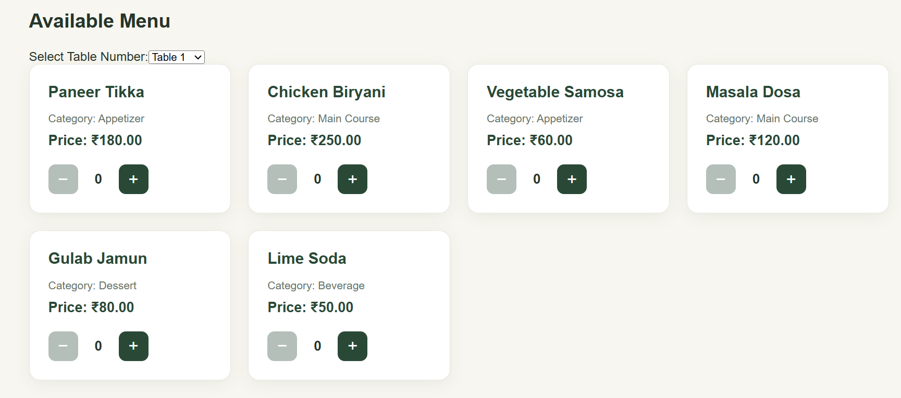
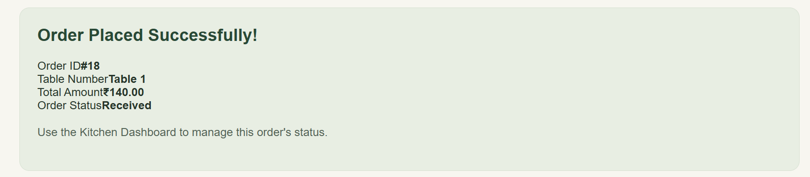
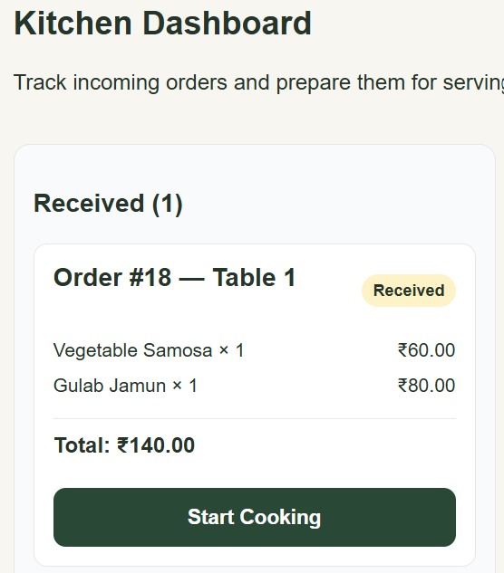
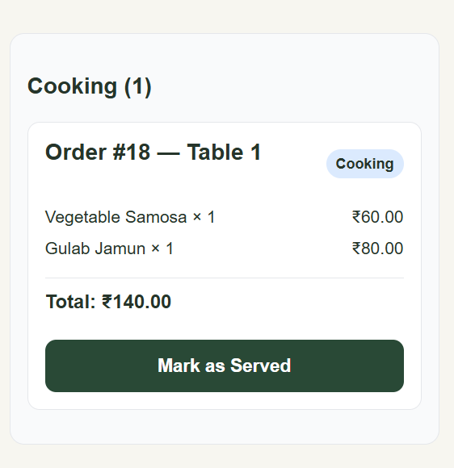
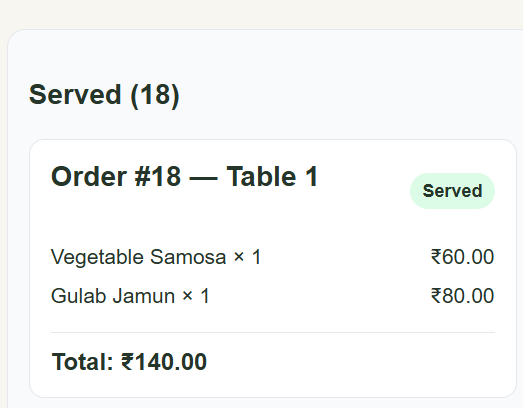

# On-Demand Kitchen Menu & Order Router

## Project Overview

The **On-Demand Kitchen Menu & Order Router** is a web application for managing restaurant menu items and customer orders. Customers can browse available dishes, select quantities, choose a table number, and place orders. Kitchen staff can view orders and update their status from Received to Cooking to Served.

The project uses Flask for the backend, SQLite for database storage, and React for the frontend.

## Features

- View available menu items and their prices.
- Add menu items through the API.
- Update menu item availability.
- Select a table number when placing an order.
- Place orders containing multiple menu items.
- Calculate order totals using database prices.
- View order details, quantities, and subtotals.
- Display table numbers on kitchen orders.
- Display all orders in the kitchen dashboard.
- Update order status from `Received` to `Cooking` to `Served`.
- Validate order quantities and reject duplicate menu items.
- Handle invalid requests with error responses.
- Run automated backend tests using pytest.

## Technologies Used

| Technology | Purpose |
|---|---|
| Python | Backend programming |
| Flask | REST API development |
| SQLite | Database storage |
| React | Frontend development |
| Vite | Frontend development server |
| pytest | Backend testing |
| uv | Python dependency management |
| Git and GitHub | Version control |

## Project Screenshots

### 1. Customer Menu

Customers can browse dishes, select quantities, choose a table number, and view their order total.



### 2. Order Confirmation

After placing an order, the customer sees the order confirmation, table number, and total amount.



### 3. Kitchen Dashboard — Received

New orders appear in the Received column for kitchen staff to process.



### 4. Kitchen Dashboard — Cooking

Kitchen staff can move an order to Cooking when preparation begins.



### 5. Kitchen Dashboard — Served

After preparation, the order status can be updated to Served.



## Project Structure

```text
kitchen_router/
├── backend/
│   ├── src/
│   │   └── backend/
│   │       ├── __init__.py
│   │       ├── app.py
│   │       ├── database.py
│   │       ├── menu.py
│   │       └── orders.py
│   ├── tests/
│   │   └── test_api.py
│   ├── pyproject.toml
│   └── uv.lock
├── frontend/
│   ├── src/
│   ├── package.json
│   └── ...
├── project_docs/
│   └── screenshots/
│       ├── customer-menu.png
│       ├── order-confirmation.png
│       ├── order-received.png
│       ├── order-cooking.png
│       └── order-served.png
├── API_DOCUMENTATION.md
└── README.md
```

## Prerequisites

Install the following:

- Python 3.13 or a compatible version supported by the project
- uv
- Node.js and npm
- Git

## Setup and Installation

### 1. Clone the Repository

```bash
git clone https://github.com/Siddartha-143/nexturn_miniproject.git
cd nexturn_miniproject
```

### 2. Start the Backend

Open a terminal in the project root:

```bash
cd backend
uv sync --dev
uv run python -m backend.app
```

The backend runs at `http://127.0.0.1:5000`.

The application initializes the SQLite database when it starts.

### 3. Start the Frontend

Open a second terminal in the project root:

```bash
cd frontend
npm install
npm run dev
```

Open the local URL printed by Vite, usually `http://localhost:5173`.

Keep both terminals running while using the application.

## Using the Application

### Customer Menu

1. Open the frontend in your browser.
2. Browse the available menu items.
3. Select quantities using the plus and minus buttons.
4. Choose a table number.
5. Review the order total.
6. Place the order and view the confirmation.

### Kitchen Dashboard

1. Open the Kitchen Dashboard from the navigation.
2. View orders grouped by `Received`, `Cooking`, and `Served`.
3. Review each order's table number, items, quantities, and total.
4. Update the status as the order progresses.

## API Endpoints

Base URL: `http://127.0.0.1:5000/api`

| Method | Endpoint | Description |
|---|---|---|
| GET | `/health` | Check backend status |
| POST | `/menu` | Add a menu item |
| GET | `/menu` | Get menu items |
| GET | `/menu/active` | Get available menu items |
| PATCH | `/menu/<item_id>/availability` | Update menu item availability |
| POST | `/orders` | Place a new order |
| GET | `/orders` | Get all orders for the kitchen dashboard |
| GET | `/orders/<order_id>` | Get details of one order |
| PATCH | `/orders/<order_id>/status` | Advance an order's status |

### Example: Add a Menu Item

`POST /api/menu`

```json
{
  "name": "Paneer Tikka",
  "price": 180,
  "category": "Appetizer"
}
```

### Example: Place an Order

`POST /api/orders`

```json
{
  "table_number": 6,
  "items": [
    {
      "menu_item_id": 1,
      "quantity": 2
    }
  ]
}
```

The backend retrieves prices from the database and calculates the total.

### Example: Update Menu Availability

`PATCH /api/menu/1/availability`

```json
{
  "available": false
}
```

Set `available` to `true` to make the item available again.

### Order Status Flow

```text
Received → Cooking → Served
```

An order cannot advance beyond `Served`.

## Running Tests

Run the backend tests from the `backend` directory:

```bash
uv run pytest -v
```

The current test suite contains 10 tests covering menu creation, active menu retrieval, order totals, unavailable items, order status progression, menu availability, invalid quantities, duplicate menu items, missing order items, and invalid JSON.

## Database

The application uses SQLite with three tables:

- `menu_items`: stores menu item names, prices, categories, and availability.
- `orders`: stores order totals, statuses, and table numbers.
- `order_items`: stores the menu items and quantities associated with each order.

The local database is generated by the application and should not be committed to Git.

## Version Control

Git and GitHub are used to track project changes. Commits use descriptive messages to make the development history easier to understand.

GitHub Repository: https://github.com/Siddartha-143/nexturn_miniproject

## Future Improvements

- Add authentication for kitchen staff.
- Improve automated test coverage.
- Add deployment configuration.
- Improve database management and error handling.

## Author

Developed as part of the Kapston mini-project.
